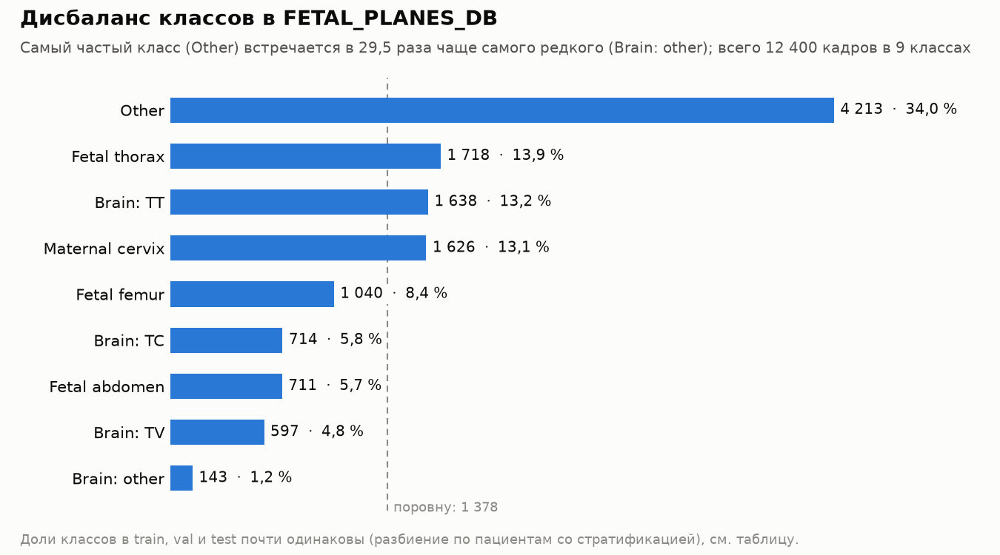

# Препроцессинг FETAL_PLANES_DB: итоговый отчёт

Проект NeuroML 2026 №3 «Architecture Benchmark for Fetal Ultrasound Plane Classification» · зона ответственности: Максим · ветка `preprocessing`.
Все оценки качества в этом документе получены на val (разбиение по пациентам); **test на этом этапе не использовался**.

**Содержание:** 1. Резюме · 2. Данные: что нашли и что сделали · 3. Разбиения и подвыборки · 4. Финальный пайплайн изображения ·
5. Как выбирали препроцессинг (абляция) · 6. Эффективность данных (п. e) · 7. Рассуждения и самокритика · 8. Ограничения ·
9. Что не сделано и открытые вопросы · 10. Воспроизведение и карта файлов

## 1. Резюме

**Финальный препроцессинг (B0):** серый → letterbox 224 (пропорции сохраняются, чёрная добивка) → на train умеренные аугментации
(аффин ±10°, масштаб 0,9–1,1, сдвиг ±5 %, яркость и контраст ±20 %) → 3 одинаковых канала → ImageNet mean/std. Без отражения по горизонтали, без кропа
сектора, без маски интерфейса. Выбор сделан по правилу, заданному до эксперимента (24 прогона: 7 вариантов и база × 3 seed): вариант принимается, если средняя разность
macro-F1 с базой ≥ 1 п.п., а 95%-й интервал парного бутстрэпа по группам пациентов выше нуля. **Ни один вариант правило не прошёл**, поэтому финальной остаётся база.

**Ориентир качества** (ResNet-18 с ImageNet-весами, val, 3 seed): macro-F1 **0,846 ± 0,004**, balanced accuracy 0,837 ± 0,006. Это точка отсчёта для архитектурного бенчмарка,
а не итоговый результат проекта.

**Главное, что нашли в данных** (раздел 2):
1. 5 пациентов записаны дважды под разными ID: разбиваем по `patient_group` (1792 → 1787 групп), утечек между частями нет.
2. 1486 кадров — точные копии друг друга (653 группы); 18 пар одинаковых картинок с разными подписями (36 кадров) — шум разметки.
3. Официальный test непохож на train: Voluson S10 — 20,3 % test против 0,17 % train.
4. Класс связан с аппаратом (*Other* — 60 % кадров Aloka и 10 % E6), оператор почти определяется аппаратом, а 7 форматов кадров (12,1 % данных) однозначно определяют класс:
   это шорткаты, которые препроцессинг не убирает.
5. Редкий класс *Brain: other*: 143 кадра (1,2 %); в val всего 20 кадров из 16 групп, его оценки шумные.

**Главное, что показал эксперимент** (разделы 5–6):
- кроп сектора почти ничего не меняет (у 89 % кадров сектор и так заполняет кадр); маска интерфейса не убирает узнаваемость аппарата (проба: 98–99,6 % при любом входе);
- единственный намёк на улучшение — кроп + маска: +1,3 п.п. [−0,1; +2,8], **не подтверждён**;
- качество растёт с числом обучающих пациентов (25 → 50 → 100 %: 0,778 → 0,815 → 0,846), причём разрыв объясняется нехваткой пациентов, а не недообучением (контрольный прогон).

**Что готово для команды:**

| Что | Где |
|---|---|
| Метки, дубликаты, `patient_group`, три разбиения, контрольная сумма | `data/processed/metadata.csv`, `splits.sha256` (раздел 3) |
| Подвыборки 25 / 50 % обучающих пациентов (вложенные, стратифицированные) | колонки `split_grouped_f25`, `split_grouped_f50`, `subsets.sha256` |
| Dataset и загрузчик (проверены на torch/MPS, воспроизводимые аугментации) | `fetal/datasets.py` (`FetalPlanesDataset`, `make_loader`) |
| Метрики (macro-F1, balanced accuracy, по классам, аппаратам, срезам) и парный бутстрэп | `fetal/metrics.py`, `fetal/bootstrap.py`, `fetal/report.py` |
| Конфиги экспериментов и результаты | `configs/`, `results/` (карта в разделе 10) |

**Главные ограничения** (подробно в разделе 8): одна архитектура (ResNet-18); один val из 259 групп (интервалы ≈ ±1,4 п.п.); шорткаты по аппарату и формату остаются, а пользуется ли ими
дообученная модель, не проверено; доля кадров с экранным текстом («≈ 92 %») не измерена.

## 2. Данные: что нашли и что сделали

Набор: 12 400 кадров, 1792 пациента, 9 классов (5 плоскостей и *Fetal brain*, разбитый на TT / TC / TV / other), 4 категории аппаратов (Aloka, Voluson E6, Voluson S10 и смесь «Other»).

### 2.1. Дисбаланс классов



Самый частый класс (*Other*, 34,0 %) встречается в 29,5 раза чаще самого редкого (*Brain: other*, 1,2 %). Доли классов в train, val и test почти одинаковы (отклонение ≤ 0,1 п.п.).
Таблица с числами по частям: `results/figures/class_imbalance.csv`. Поэтому везде, кроме общей оценки, смотрим macro-F1, balanced accuracy и F1 по классам, а brain-подклассы отдельно.

### 2.2. Проблемы с данными: как нашли и что сделали

| Проблема | Масштаб | Как нашли | Что сделали |
|---|---|---|---|
| Пациенты-дубликаты под разными ID | 5 пар (778↔790, 779↔791, 781↔793, 786↔799, 820↔830) | отпечаток кадра (уменьшенная копия 9×8 + 32×32), пара пациентов считается одним человеком при ≥ 3 совпавших кадрах | разбиваем по `patient_group` (1787 групп), утечек 0 (тест) |
| Точные копии кадров | 1486 кадров в 653 группах; внутри пациента 1406 в 615 группах | MD5 по пикселям серого | не удаляем, помечаем `dup_group`; копии не пересекают части |
| Одна картинка, разные подписи | 18 пар = 36 кадров; 30 из них в официальном test | группы одинаковых MD5 с разными `cls9` | не правим, помечаем `label_conflict`; верхняя граница качества на brain-подклассах ниже 100 % |
| Ложные «почти-дубликаты» между пациентами | единичные пары, в основном S10 | просмотр найденных пар глазами | порог ≥ 3 совпавших кадров (остаточный риск: пропуск дубля с 1–2 совпадениями) |
| Официальный test не похож на train | S10: 20,3 % test против 0,17 % train | подсчёт аппаратов по частям | основное разбиение — своё `split_grouped`; официальное оставлено как второй вариант |
| Класс связан с аппаратом и оператором | V Крамера ≈ 0,3; *Other* — 60 % Aloka, 49 % S10, 10 % E6, 6 % аппарата Other (train); Op. 3 только на Aloka, Op. 1 и 2 только на E6 | таблицы «аппарат × класс», контроли без картинки | смягчено балансом разбиения; остаётся (разделы 5, 7, 8) |
| Формат кадра определяет класс | 7 форматов Aloka, 1496 кадров (12,1 %): четыре сплошь *Other* (экраны измерений), три сплошь *Maternal cervix* | доля главного класса по формату (аппарат + размер) | не устранимо препроцессингом; каждая оценка считается отдельно на «чистых» и «смешанных» форматах |

Пары кадров с разными подписями выгружены отдельным архивом для просмотра экспертом (лежит на рабочем столе, не в репозитории).

Графики: [размеры кадров по аппаратам](../results/figures/image_sizes_by_machine.png) ·
[до/после, Aloka](../results/figures/before_after_Aloka.png), [E6](../results/figures/before_after_Voluson_E6.png), [S10](../results/figures/before_after_Voluson_S10.png),
[Other](../results/figures/before_after_Other.png) · [аугментации](../results/figures/augmentations.png).
Визуально у каждого аппарата свой интерфейс (шкала, блоки текста, у Aloka есть целые экраны допплера и M-режима, класс *Other*).

### 2.3. Подробности находок

1. **5 пациентов продублированы под другими ID** (все в официальном train, Voluson E6):
   778↔790, 779↔791, 781↔793, 786↔799, 820↔830 (10–29 общих кадров на пару).
   Если разбивать по `Patient_num`, такие пары могут попасть в train и test. Поэтому группа для
   разбиения — `patient_group` (пациенты с ≥3 общими почти-дубликатами объединены; 1792 → 1787 групп).
   Единичные «почти-дубликаты» между разными пациентами (в основном Voluson S10) на просмотре —
   разные снимки, порог dHash≤4 и MAD≤4 даёт ложные срабатывания, поэтому используется правило ≥3 пар.
2. **Побитовые дубликаты**: 1486 изображений в 653 группах (833 лишних); из них внутри одного пациента —
   1406 изображений в 615 группах (791 лишнее), ещё 42 группы встречаются у разных пациентов. Не удаляются,
   в таблице помечены `dup_group`. Утечки между частями нет (проверено, 0 групп пересекают части).
3. **Конфликты меток**: 36 изображений в 18 группах пиксельно идентичных картинок с разными метками
   (чаще TT↔TV, Brain: other↔Fetal abdomen); 30 из 36 — в официальном test. Это шум разметки,
   верхняя граница достижимого качества на brain-подклассах ниже 100 %. Колонка `label_conflict`.
4. **Размеры и режимы**: 280×196 … 1605×787, соотношение сторон 0.63–2.37; 45 RGBA (альфа везде 255,
   `convert("L")` безопасен). Разные сканеры имеют разный типичный размер (Aloka 640×392, E6 959×661,
   S10 1137×787), т.е. размер — признак сканера. Letterbox с пропорциями это сохраняет.

## 3. Разбиения и подвыборки

| Колонка | Протокол | Утечка |
|---|---|---|
| `split_grouped` | по `patient_group`, стратификация по 9 классам (`StratifiedGroupKFold`), ~71/14/14 %; из 50 seed выбран самый сбалансированный по классам и сканерам (seed 37) | 0 пациентов / групп / идентичных картинок |
| `split_official` | официальный Train/Test; val = 1/10 пациентов train | 0 |
| `split_naive` | случайный image-level 5:1:1 | есть (1008 пациентов в >1 части) — только для п. (d) как контроль |

Ограничения: в `split_official` test содержит 20 % Voluson S10 при 0.2 % в train (сдвиг по сканеру);
`split_grouped` эту проблему устраняет, но сканеры и операторы остаются связаны с классом (V Крамера ≈ 0.3).
Выбор seed делается только по метаданным, без модели.

**Версия протокола и scikit-learn.** Текущие `split_grouped` и `split_official` получены на scikit-learn 1.9.1
(seed 27, `imbalance_score` 0.027). Первый вариант (seed 37, sklearn ≤ 1.7.2) заменён до начала обучения
(на нём никто ничего не обучал): в 1.8.0 исправлена ошибка `StratifiedGroupKFold(shuffle=True)` (раньше
перемешивались счётчики классов групп без самих групп, стратификация работала «вслепую»; утечки не было),
и новое разбиение заметно лучше сбалансировано:

| `split_grouped` | макс. отклонение доли класса в val/test | макс. отклонение доли сканера |
|---|---|---|
| первый вариант (seed 37, sklearn ≤ 1.7.2) | 1.4 п.п. | 3.8 п.п. (Aloka в val) |
| текущий (seed 27, sklearn ≥ 1.8) | 0.1 п.п. | 1.4 п.п. |

**Воспроизводимость обеспечивает сам CSV, а не seed и версия библиотеки:** `fetal.prepare` записывает рядом
`data/processed/splits.sha256` (хэш соответствия image → часть по трём разбиениям), и тест
`test_split_columns_match_frozen_checksum` падает, если разбиения изменились. Менять их можно только осознанно
(`--force` + обновлённый хэш + сообщение команде) и как новую версию протокола: все сравниваемые модели
должны обучаться на одном и том же. Если `fetal.prepare` на другой версии sklearn даст иные разбиения, это
сигнал не перезаписывать файл, а использовать CSV из репозитория. Колонка `split_naive` и все остальные
(метки, хэши, дубликаты, `patient_group`) от версии не зависят.

### 3.1. Вложенные подвыборки обучающих пациентов (для п. e)

Для «data efficiency» (переобучить финалистов на 25 / 50 / 100 % обучающих пациентов) в `metadata.csv` добавлены колонки (существующие не менялись,
проверено сверкой с git); их считает `python -m fetal.subsets` (или `python -m fetal.prepare`), код — `fetal/subsets.py`:

| Колонка | Смысл |
|---|---|
| `train_fold` | 0–3 у кадров train, −1 у val/test; 25 % = фолд 0, 50 % = фолды 0–1, 100 % = все |
| `split_grouped_f25` | как `split_grouped`, но кадры train вне 25 % подвыборки помечены `unused`; val и test те же |
| `split_grouped_f50` | то же для 50 %; 100 % — это сам `split_grouped` |

Использование: `FetalPlanesDataset(meta, "data/raw", "split_grouped_f25", "train", ...)` или `"split_col": "split_grouped_f25"` в конфиге обучения.

Свойства (проверяются `validate_subsets` и тестами):
- **вложенность**: каждый пациент из 25 % входит в 50 %, из 50 % — в 100 %;
- **единица выборки — `patient_group`**: пациенты-дубликаты всегда вместе, ни одна группа не делится между взятыми и неиспользуемыми кадрами;
- **стратификация** по 9 классам и 4 аппаратам: максимальное отклонение долей от полного train ≤ 0,03 п.п.; размеры ровно 25,0 и 50,0 % кадров;
- **фиксированный seed** (0) и детерминизм без зависимости от версий библиотек: порядок групп и фолдов задаёт хэш (seed, группа), а не scikit-learn или numpy
  (разбиения зависели от версии scikit-learn, здесь этого повторять не хотелось); контрольная сумма в `data/processed/subsets.sha256`, тест её проверяет.

| Подвыборка | кадров | групп пациентов | макс. откл. классов | макс. откл. аппаратов | мин. кадров в классе |
|---|---|---|---|---|---|
| 25 % | 2213 | 318 | 0,02 п.п. | 0,02 п.п. | 25 (*Brain: other*) |
| 50 % | 4425 | 636 | 0,03 п.п. | 0,01 п.п. | 50 |
| 100 % | 8851 | 1273 | 0 | 0 | 102 |

Оговорки: подвыборка одна (seed 0): различия между подвыборками одного размера не учтены (при желании можно взять несколько seed); в 25 % у самого редкого
класса *Brain: other* всего 25 кадров из ≈ 21 группы, поэтому его F1 на малых долях будет шумным; val фиксирован, поэтому кривая показывает эффект размера
обучающей выборки, а не смены оценочной. Конфиг для запуска на B0 как демонстрации: `configs/data_efficiency.json`
(`python -m fetal.train --config configs/data_efficiency.json --all --seed 0 1 2 --out results/data_efficiency`; 100 % — B0 из абляции).

## 4. Финальный пайплайн изображения (B0)

`convert("L")` → letterbox (длинная сторона = 224, бикубика, чёрная добивка) → [train: аффин ±10°,
масштаб 0.9–1.1, сдвиг ±5 %, яркость/контраст ±20 %] → 3 одинаковых канала → ImageNet mean/std.

Финальный препроцессинг подтверждён абляцией (см. «Абляция препроцессинга: результаты и выбор»); допущения проверены:
- отражение по горизонтали выключено: включение ничего не дало (+0,2 п.п., интервал включает ноль);
- размер 224: 320 не оправдывает вдвое большего времени (+0,6 п.п., интервал включает ноль); 224 подходит и для ViT/Swin без изменений;
- экранные интерфейсы не маскируются и сектор не кропается: маска и кроп не дали надёжного выигрыша и не убирают узнаваемость аппарата (проба);
  **риск шортката по сканеру и формату остаётся** и описан в ограничениях.

### 4.1. Загрузка данных в torch (проверено на macOS, Apple M4, MPS)

```python
torch.manual_seed(seed)                       # фиксирует и порядок батчей, и аугментации
ds = FetalPlanesDataset(meta, "data/raw", "split_grouped", "train", train=True)
dl = make_loader(ds, batch_size=64, shuffle=True, num_workers=8)
```

- Батч: `x` — `float32 [B, 3, 224, 224]`, `y` — `int64 [B]`; сквозной шаг обучения на MPS работает.
- Аугментации воспроизводимы при тех же `seed`, `batch_size` и `num_workers` (как у torchvision);
  при разном `num_workers` батчи другие. Раньше при `num_workers=0` они не воспроизводились: брался
  глобальный `random`, который `torch.manual_seed` не сидирует (исправлено, есть тест).
- `make_loader` на macOS включает `forkserver` и `persistent_workers`: с дефолтным `spawn` (torch 2.14,
  Python 3.12) завершение воркеров занимает ~10–16 с на каждый проход по лоадеру, т.е. на каждую эпоху.
- Скорость на M4 (обучение / инференс, img/s): ResNet-18 — 151 / 533 при 224 и 77 / 280 при 320;
  ResNet-50 — 50 / 160 и 25 / 86. Загрузка с 8 воркерами ~600 img/s, узким местом не является.

## 5. Как выбирали препроцессинг (абляция)

**Идея.** Критерий курса требует сравнить несколько вариантов препроцессинга и обосновать выбор. Базовый пайплайн из задания (серый, 3 канала, сохранение пропорций, умеренные аугментации)
фиксирован, а проверялись параметры, выбор которых не очевиден: область кадра (кроп сектора, маскирование интерфейса), разрешение, отражение, сила аугментаций. Это 7 вариантов, каждый отличается от
базы одним параметром; «по одному за раз» гарантирует, что разница объясняется именно им. Перед абляцией проверена инфраструктура (этап 0) и показано, что аппарат и формат кадра несут информацию о классе (контроли без картинки), то есть риск шорткатов реален.

### Этап 0 абляции: инфраструктура и что выяснилось

Построено (все команды из корня; артефакты `data/cache/` в `.gitignore`, пересоздаются за ~1,5 мин):

| Команда | Что делает |
|---|---|
| `python -m fetal.sector` | `data/cache/sector.csv`: бокс и выпуклая оболочка УЗ-сектора, флаг уверенности (`fetal/sector.py`) |
| `python -m fetal.overlay` | `data/cache/overlay_masks.npz`: маски статичного интерфейса по формату кадра, считаются **только по train** (`fetal/overlay.py`) |
| `python -m fetal.controls` | контроли шортката без картинки: `results/stage0/controls.json` |
| `python -m fetal.train --config configs/ablation.json --all --seed 0 1 2` | обучение ResNet-18 (ImageNet) по вариантам; `results/ablation/<вариант>/seed<k>/` |
| `python -m fetal.probe` | проба «предскажи аппарат / оператора» по замороженным эмбеддингам для A0–A3: `results/probe/` |
| `python -m fetal.report` | среднее ± std по seed, парный бутстрэп по `patient_group` против B0, график и `decision.json` с выбором по заранее заданному правилу (`fetal/report.py`) |

Варианты области кадра (`fetal/regions.py`): **A0** полный кадр; **A1** кроп бокса сектора; **A2** маска интерфейса без кропа;
**A3** маска интерфейса + кроп + закраска вне оболочки. Конфиг `configs/ablation.json`: 8 вариантов, каждый отличается от B0 ровно
одним параметром (проверяет тест). Test в `fetal/train.py` недоступен (только `train`/`val`); выбор — последняя эпоха, без отбора по val.

#### Находки

1. **Формат кадра у части данных определяет класс.** 7 форматов (все Aloka) почти чисты по классу: 692×480, 768×519, 647×381, 384×259 — только
   *Other* (экраны измерений, допплер, M-режим; 1060 кадров), 869×601, 745×559, 753×567 — только *Maternal cervix* (436 кадров). Всего 1496 кадров
   (12,1 % данных). Letterbox сохраняет пропорции, поэтому такой шорткат остаётся в любом варианте. Поэтому каждый прогон считает метрики
   отдельно на кадрах из «чистых» и «смешанных» форматов (`per_subset`; чистота определяется по train).
2. **Безопасный кроп сектора почти ничего не меняет.** Сектор на этих кадрах уже заполняет кадр: у 89 % кадров бокс ≥ 95 % площади.
   Оболочка берётся по всем существенным областям (тёмная жидкость у края режет сектор на куски; при выборе только самого большого куска оболочка
   отрезала бы анатомию, это и было видно на первой версии). Потеря яркости вне оболочки в среднем ≈ 1 %. Более высокий порог яркости кропит больше
   кадров (30 % вместо 10 %), но теряет до 10 % содержимого, поэтому не использован. Ожидаемо: A1 ≈ A0.
   Запасной вариант (кадр без изменений) нужен лишь 7 кадрам из 12 400 (6 в train). Проверено глазами: 36 кадров по одному на ячейку
   «аппарат × класс» и 36 кадров с самыми маленькими боксами (`results/stage0/sector_check_*.png`) — анатомия везде внутри бокса.
3. **Маска интерфейса.** Интерфейс стоит на одном месте у всех кадров формата, анатомия двигается: пиксель считается интерфейсом, если тонкий яркий
   штрих в нём встречается у ≥ 30 % кадров формата (при 10 % спекл ткани закрашивал до 40 % кадра в однотипных форматах). Маски есть у 14 форматов
   (97,9 % кадров), закрашено 0–14 % кадра, у основных форматов 1–3 %. Предохранитель: маска > 20 % кадра не используется.
   Сравнение вариантов на реальных кадрах: `results/stage0/regions_check.png`.
4. **Контроли без картинки** (train → val; справочные линии, не пороги):

| Признаки | macro-F1 класса | balanced acc. аппарата |
|---|---|---|
| случайно | 0,111 | 0,250 |
| отношение сторон | 0,207 | 0,785 |
| ширина × высота | 0,206 | 0,778 |
| геометрия сектора (бокс, площадь, пропорции) | 0,272 | 0,831 |
| наличие и доля маски интерфейса | 0,208 | 0,980 |
| всё вместе | 0,283 | 0,989 |

   Результат ниже этих линий не доказывает, что модель не использует аппарат, а выше — что использует. Геометрия кропа сама несёт
   информацию о классе (0,272 против 0,207 у пропорций), поэтому кроп может добавить шорткат, а не убрать.
5. **Скорость на M4 (измерено с загрузкой данных и масками):** ResNet-18 ≈ 140 кадров/с при 224 (≈ 66 с эпоха с val) и ≈ 73 при 320
   (≈ 128 с). Все варианты области одинаково быстры.
6. **Проба «предскажи аппарат»** (`python -m fetal.probe`, `results/probe/`): замороженный ResNet-18, линейная голова на train, оценка на val;
   balanced accuracy **внутри класса** (7 классов, где у каждого аппарата ≥ 10 кадров в val), вес train выровнен по ячейкам «аппарат × класс»;
   аппарат Other (смесь) исключён.

| Вход | аппарат, внутри класса [95% ИД] | Δ против A0 | оператор внутри E6 (Op. 1 / Op. 2) | Δ против A0 |
|---|---|---|---|---|
| A0 полный кадр | 98,8 % [98,1; 99,5] | | 89,8 % [86,6; 92,9] | |
| A1 кроп | 98,1 % | −0,8 [−1,9; +0,3] | 89,9 % | +0,1 [−1,9; +2,2] |
| A2 маска интерфейса | 99,6 % | +0,7 [0,0; +1,5] | 90,4 % | +0,6 [−2,5; +3,6] |
| A3 кроп + маска | 97,7 % | −1,1 [−2,2; −0,1] | 86,4 % | −3,4 [−6,9; −0,1] |
| контроль: только отношение сторон | 99,9 % | | 55,6 % | |
| контроль: только класс (без выравнивания весов) | 33,3 % (обычная bal. acc. 51,1 %) | | 50,0 % | |
| случайно | 28,0 % | | 49,8 % | |

   Выводы. (а) **Ни один вариант не убирает узнаваемость аппарата**: 98–99,6 % при случайном уровне 33 %. Значит, аппарат читается не только по
   тексту интерфейса, но и по стилю изображения (форма сектора, контраст, текстура). (б) Различия между вариантами малы и **нестабильны**:
   при более сильной регуляризации (C = 0,05) Δ у A2 (+0,1) и у A3 (−0,8) уже не отличаются от нуля. (в) Контроль «только отношение сторон» даёт
   99,9 %, но это потолок «поиска по метаданным»: бустинг запоминает точные значения (E6 959×661 = 1,4508, S10 1137×787 = 1,4447 различаются лишь
   в третьем знаке, а после letterbox это около 1 px поля), а не то, что видит сеть. (г) Оператор внутри одного аппарата тоже узнаётся (≈ 90 %
   при случайном 50 %), маскирование этого не убирает; A3 снижает на 3,4 п.п. (граница интервала у нуля, разведочно). (д) Проба показывает, что
   признак МОЖНО прочитать, а не что дообученная модель им пользуется: для этого есть метрики по аппаратам и по «чистым» форматам в самой абляции.
   Следствие для правила выбора: запасной критерий «при равенстве берём вариант с меньшей узнаваемостью аппарата» **неинформативен**
   (все варианты практически равны), при равенстве выбираем более простой.
7. **Пилот B0 на 8 эпох** (один seed, `results/pilot/`): val macro-F1 по эпохам 0,709 · 0,733 · 0,794 · 0,835 · 0,827 · 0,838 · 0,842 · 0,840.
   Выход на плато к 4–6-й эпохе, разница между 6-й и 8-й эпохами 0,2 п.п. (в пределах шума), поэтому в абляции 6 эпох. Эпоха ≈ 67 с (≈ 140 кадров/с);
   на «чистых» форматах (210 кадров val) macro-F1 = 1,000, на смешанных (1560) 0,838; *Brain: other* F1 = 0,44 (20 кадров), S10 — 0,76 (155 кадров).
   Число эпох выбрано по val на одном seed; это единственный выбор по val до абляции.

#### Ограничения этапа 0
- Маска ловит тонкие штрихи (текст, линии); залитые блоки (серая шкала в левом верхнем углу Aloka) остаются.
- Форма маски одинакова у всех кадров формата, то есть сама может служить признаком формата.
- Форматы без маски (79 − 14, 2,1 % кадров) идут как в A0.
- Пороги заданы по визуальной проверке train и не подбирались по метрикам val; проверка глазами делалась одним человеком (не врачом).
- Прогоны этапа 0 были мини-запусками (≤ 1536 кадров, 1–2 эпохи) для проверки кода: их метрики ничего не значат.

### Абляция препроцессинга: результаты и выбор

**Итог: финальный препроцессинг — B0** (серый → letterbox 224 с чёрной добивкой → умеренные аугментации на train → 3 канала → ImageNet-норма;
без отражения, без кропа и маски интерфейса). Ни один из 7 вариантов не показал надёжного улучшения; выбор записан кодом в
`results/ablation/decision.json` (`final_config`, `final_equals_base: true`) и совпадает с конфигурацией B0 из `configs/ablation.json`.

**Протокол.** ResNet-18 с весами ImageNet, дообучение всей сети, 6 эпох (число эпох выбрано по пилоту на 8 эпох, один seed, по val),
AdamW lr 3e-4, batch 64, косинусное расписание; `split_grouped`; оценка **только на val** (1770 кадров, 259 групп пациентов), test не
использовался; 8 вариантов × seed 0, 1, 2 = 24 прогона; каждый вариант отличается от B0 одним параметром (проверяет тест). Последняя эпоха,
без отбора чекпоинта. Сравнение с B0 парное (те же seed, те же val-кадры); интервал — бутстрэп по `patient_group` (5000 повторов, одна выборка
групп для обеих моделей и всех seed), он отражает неопределённость состава val при уже обученных моделях, а случайность обучения показывают std
и знаки Δ по seed. **Правило выбора (задано до запуска):** средняя Δ macro-F1 ≥ 1 п.п. и нижняя граница 95%-го интервала > 0; при 7 сравнениях
без поправки выводы «лучше/хуже» разведочные (интервал с поправкой Бонферрони в `summary.md` и на графике).

| Вариант | macro-F1 (среднее ± std по 3 seed) | Δ macro-F1 против B0 [95% ИД] | Δ по seed 0 / 1 / 2, п.п. | balanced acc. | ΔBA против B0 [95% ИД] | Вывод по правилу |
|---|---|---|---|---|---|---|
| **B0** (база: полный кадр, 224, без hflip, умеренные аугментации) | 0,846 ± 0,004 | | | 0,837 ± 0,006 | | |
| A1 кроп сектора | 0,847 ± 0,011 | +0,1 п.п. [-1,2; +1,4] | +0,4 / +0,6 / -0,6 | 0,842 ± 0,013 | +0,5 п.п. [-0,8; +1,8] | различий не видно |
| A2 маска интерфейса | 0,848 ± 0,011 | +0,3 п.п. [-0,9; +1,5] | -0,9 / -0,2 / +1,9 | 0,840 ± 0,010 | +0,3 п.п. [-0,9; +1,7] | различий не видно |
| A3 кроп + маска | 0,858 ± 0,006 | +1,3 п.п. [-0,1; +2,8] | +1,4 / +0,2 / +2,2 | 0,853 ± 0,003 | +1,6 п.п. [+0,2; +3,3] | различий не видно |
| разрешение 320 (вместо 224) | 0,852 ± 0,006 | +0,6 п.п. [-1,1; +2,2] | +0,9 / -0,4 / +1,3 | 0,845 ± 0,007 | +0,8 п.п. [-0,9; +2,5] | различий не видно |
| отражение по горизонтали | 0,847 ± 0,010 | +0,2 п.п. [-1,3; +1,7] | +1,2 / -0,9 / +0,3 | 0,840 ± 0,013 | +0,3 п.п. [-1,4; +1,9] | различий не видно |
| без аугментаций | 0,836 ± 0,006 | -1,0 п.п. [-2,7; +0,7] | -1,3 / -0,7 / -1,0 | 0,831 ± 0,007 | -0,6 п.п. [-2,3; +1,0] | различий не видно |
| сильные аугментации | 0,846 ± 0,001 | +0,1 п.п. [-1,5; +1,4] | +0,1 / -0,3 / +0,5 | 0,838 ± 0,007 | +0,1 п.п. [-1,4; +1,4] | различий не видно |

График: [results/ablation/ablation_delta_f1.png](../results/ablation/ablation_delta_f1.png) (точка — среднее Δ, толстая линия — 95% ИД,
тонкая — с поправкой на 7 сравнений, кружки — Δ отдельных seed). Полная таблица: `results/ablation/summary.md`.

Срезы (macro-F1, среднее ± std по 3 seed; по аппаратам — по классам, присутствующим у аппарата):

| Вариант | Aloka | Voluson E6 | Voluson S10 | смешанные форматы | «чистые» форматы | Brain: TT | Brain: TC | Brain: TV | Brain: other |
|---|---|---|---|---|---|---|---|---|---|
| B0 | 0,875 ± 0,001 | 0,820 ± 0,011 | 0,763 ± 0,001 | 0,843 ± 0,004 | 1,000 ± 0,000 | 0,855 ± 0,008 | 0,849 ± 0,011 | 0,782 ± 0,003 | 0,445 ± 0,029 |
| A1 кроп сектора | 0,880 ± 0,009 | 0,821 ± 0,015 | 0,754 ± 0,011 | 0,844 ± 0,011 | 1,000 ± 0,000 | 0,856 ± 0,011 | 0,870 ± 0,025 | 0,769 ± 0,008 | 0,438 ± 0,075 |
| A2 маска интерфейса | 0,873 ± 0,007 | 0,828 ± 0,021 | 0,744 ± 0,011 | 0,846 ± 0,012 | 1,000 ± 0,000 | 0,855 ± 0,016 | 0,861 ± 0,007 | 0,751 ± 0,014 | 0,485 ± 0,055 |
| A3 кроп + маска | 0,880 ± 0,012 | 0,838 ± 0,009 | 0,767 ± 0,019 | 0,856 ± 0,006 | 1,000 ± 0,000 | 0,862 ± 0,014 | 0,877 ± 0,012 | 0,777 ± 0,009 | 0,515 ± 0,039 |
| разрешение 320 (вместо 224) | 0,873 ± 0,013 | 0,827 ± 0,010 | 0,781 ± 0,012 | 0,849 ± 0,005 | 1,000 ± 0,000 | 0,861 ± 0,006 | 0,862 ± 0,006 | 0,784 ± 0,013 | 0,448 ± 0,053 |
| отражение по горизонтали | 0,886 ± 0,005 | 0,825 ± 0,014 | 0,769 ± 0,012 | 0,845 ± 0,010 | 1,000 ± 0,000 | 0,856 ± 0,015 | 0,855 ± 0,033 | 0,780 ± 0,027 | 0,437 ± 0,056 |
| без аугментаций | 0,874 ± 0,006 | 0,800 ± 0,012 | 0,762 ± 0,004 | 0,833 ± 0,006 | 1,000 ± 0,000 | 0,851 ± 0,016 | 0,840 ± 0,018 | 0,783 ± 0,008 | 0,373 ± 0,039 |
| сильные аугментации | 0,872 ± 0,008 | 0,830 ± 0,010 | 0,768 ± 0,009 | 0,844 ± 0,001 | 1,000 ± 0,000 | 0,853 ± 0,008 | 0,854 ± 0,018 | 0,771 ± 0,012 | 0,454 ± 0,028 |

#### Что показала абляция по параметрам

- **(a) область кадра.** Кроп сектора (A1) эквивалентен базе: сектор уже заполняет кадр (у 89 % кадров бокс ≥ 95 % площади). Маска интерфейса (A2) тоже
  не дала выигрыша и, по пробе, не убирает узнаваемость аппарата (98–99,6 % при любом входе). **A3 (кроп + маска)** — единственный намёк на улучшение:
  Δ = +1,3 п.п. [−0,1; +2,8], положительная на всех 3 seed, по balanced accuracy интервал выше нуля (+1,6 [+0,2; +3,3]), лучше на E6 (0,838 против 0,820) и на
  *Brain: TC* и *Brain: other*. По главной метрике интервал задевает ноль, а с поправкой на 7 сравнений ([−0,4; +3,6] п.п.) тем более;
  это **неподтверждённая гипотеза**, а не результат.
- **(b) разрешение 320** (+0,6 [−1,1; +2,2]) не оправдывает вдвое большего времени (13 против 7 минут на прогон).
- **(c) отражение по горизонтали** (+0,2 [−1,3; +1,7]) ничего не даёт; оставлено выключенным (зеркалит экранный текст и сторону анатомии).
- **(d) аугментации.** Без аугментаций хуже на всех 3 seed (−1,3 / −0,7 / −1,0 п.п.), особенно на E6 (0,800 против 0,820) и *Brain: other*, но интервал [−2,7; +0,7]
  захватывает ноль; сильные аугментации неотличимы от умеренных. Оставлены умеренные.
- **Шорткаты.** На «чистых» по классу форматах (210 кадров val) macro-F1 = 1,000 у всех вариантов, на смешанных 0,833–0,856, почти как в общем зачёте: общий результат
  формат заметно не завышает, но отделить «понял анатомию» от «узнал формат» на этих 12 % кадров нельзя.

#### Ограничения абляции

- Одна архитектура (ResNet-18): выводы могут не перенестись на ViT, Swin, ConvNeXt, DenseNet.
- Один val (259 групп): интервалы ≈ ±1,4 п.п. Различия меньше ≈ 1,5 п.п. надёжно не оцениваются, а больше seed этот интервал не сузят (нужны другие выборки пациентов).
- Малые ячейки: *Brain: other* — 20 кадров из 16 групп (F1 от 0,37 до 0,52), S10 — 17 групп; аппарат Other (смесь, 61 кадр) в таблицах не показан.
- Гиперпараметры (lr, число эпох) не подбирались под каждый вариант; MPS не гарантирует побитовой воспроизводимости между машинами.
- Семь сравнений с одной базой: без поправки выводы разведочные; поправка не меняет итога (ни один вариант не прошёл и без неё).
- Проба «предскажи аппарат» показывает, что аппарат можно прочитать по входу, но не что модель им пользуется. Доля кадров с текстом («≈ 92 %») по-прежнему не измерена.
- Test в абляции не использовался; оценка финальной конфигурации на test — отдельный шаг.

Воспроизведение: `python -m fetal.train --all --seed 0 1 2` (результаты в `results/ablation/`, прогоны с готовым `metrics.json` пропускаются), затем
`python -m fetal.report --root results/ablation` (сводка, график, `decision.json`).

## 6. Эффективность данных (п. e)

ResNet-18 (конфиг B0), 3 seed, val; 100 % — B0 из абляции. Команды: `python -m fetal.train --config configs/data_efficiency.json --all --seed 0 1 2 --out results/data_efficiency`,
затем `python -m fetal.curve` (таблица `results/data_efficiency/curve.md`, график [curve.png](../results/data_efficiency/curve.png)).

| Доля обучающих пациентов | macro-F1 (± std по seed) [95% ИД] | balanced acc. | F1 Brain: other | F1 Brain: TV | F1 S10 | F1 E6 | F1 Aloka |
|---|---|---|---|---|---|---|---|
| 25 % | 0,778 ± 0,008 [0,751; 0,803] | 0,765 ± 0,004 | 0,222 | 0,701 | 0,656 | 0,763 | 0,818 |
| 50 % | 0,815 ± 0,006 [0,785; 0,842] | 0,802 ± 0,005 | 0,304 | 0,736 | 0,720 | 0,786 | 0,866 |
| 100 % | 0,846 ± 0,004 [0,818; 0,872] | 0,837 ± 0,006 | 0,445 | 0,782 | 0,763 | 0,820 | 0,875 |

Парное сравнение шагов (те же seed и val-кадры, бутстрэп по `patient_group`):

| Шаг | Δ macro-F1 [95% ИД] | Δ по seed, п.п. |
|---|---|---|
| 25 % → 50 % | +3,6 п.п. [+1,7; +5,8] | +2,9 / +5,3 / +2,7 |
| 50 % → 100 % | +3,1 п.п. [+1,3; +5,2] | +3,4 / +2,7 / +3,1 |

- Качество растёт на каждом удвоении выборки и положительно на всех 3 seed; плато к 100 % не видно (что дало бы ещё удвоение, не проверялось).
- Сильнее всего от данных зависят редкие классы и малые аппараты: F1 *Brain: other* 0,222 → 0,445, S10 0,656 → 0,763 (эти ячейки малы и шумны: 20 кадров и 17 групп в val).
- 95%-е интервалы самих точек широкие (≈ ±2,6 п.п.): это неопределённость состава val; шаги между долями при этом значимы, потому что сравнение парное.
- **Контроль на недообучение** (`configs/data_efficiency_equal_steps.json`, `results/data_efficiency_eqsteps/`, 1 seed). При одинаковых 6 эпохах 25 % получает в 4 раза меньше шагов
  оптимизации, поэтому разрыв мог быть недообучением. Проверка: 25 % при том же числе шагов и просмотренных кадров (24 эпохи, 816 шагов против 828 у 100 % при 6 эпохах), seed 0:

  | Вариант (seed 0) | macro-F1 | balanced acc. | F1 *Brain: other* | F1 S10 |
  |---|---|---|---|---|
  | 25 %, 6 эпох | 0,783 | 0,766 | 0,276 | 0,652 |
  | 25 %, 24 эпохи (равные шаги) | 0,789 | 0,776 | 0,143 | 0,700 |
  | 100 %, 6 эпох | 0,847 | 0,842 | 0,471 | 0,764 |

  Равное число шагов дало лишь +0,6 п.п. [−2,3; +3,7] (в пределах шума; val macro-F1 выходит на плато ≈ 0,79 с 15-й эпохи, train loss к концу 0,006), а до 100 % остаётся
  **+5,8 п.п. [+2,9; +8,7]** (парный бутстрэп по группам). Из разрыва 6,3 п.п. равное число шагов закрывает ≈ 9 %: **разрыв объясняется нехваткой пациентов, а не недообучением.**
  Оговорки: один seed (шум между seed ≈ 1 п.п., эффект много больше); длина прогрева в шагах другая (1 эпоха), 50 % при равных шагах (12 эпох) не считался; подвыборка одна
  (seed 0), архитектура одна, гиперпараметры не подбирались под долю.
- Для пункта (e\*) эту же процедуру нужно повторить для финалистов Семёна: подвыборки (`split_grouped_f25`, `split_grouped_f50`) и скрипт `fetal.curve` готовы.

## 7. Рассуждения и самокритика

**Почему маска интерфейса не убрала узнаваемость аппарата?** Гипотезы, от более правдоподобной к менее (ни одна специально не проверялась):
1. аппарат читается по стилю самого изображения — контраст, зернистость (спекл), форма и яркость сектора, обработка, которую делает конкретный прибор; текст лишь один из признаков;
2. остаётся геометрия: пропорции кадра и поля после letterbox, форма сектора (контроль по геометрии даёт 83 % аппарата);
3. маска ловит тонкие штрихи и пропускает залитые блоки (серая шкала Aloka), а форма самой маски у каждого формата своя;
4. проба слабая (линейная голова на ImageNet-признаках), и по ней нельзя утверждать, чем пользуется дообученная сеть.
Как проверить: Grad-CAM для пробы аппарата, проба на вырезанных участках ткани, выравнивание контраста и гистограмм перед пробой, сравнение с пробой на случайно перемешанных блоках.

**Почему ни один вариант не прошёл правило?** Возможно, предобученной сети безразличны эти шаги; возможно, различия есть, но меньше разрешающей способности val (≈ 1,5 п.п. при 259 группах); возможно, мешает шум меток
(18 пар) и малые ячейки. Данные не позволяют различить эти объяснения; честный вывод: «различий не видно», а не «различий нет».

**Что шло не так по дороге (и что мы с этим сделали):**
- Разбиения зависели от версии scikit-learn (в 1.8 исправлена ошибка `StratifiedGroupKFold`): обнаружено при воспроизведении на новой машине; разбиения пересобраны до начала обучения и закреплены контрольной суммой.
- Первая версия детектора сектора брала только самый большой кусок (тёмная жидкость у края режет сектор на части), и кроп отрезал бы анатомию: поймано проверкой «доля яркости внутри оболочки».
- Первая маска интерфейса при низком пороге закрашивала до 76 % кадра у однотипных форматов (спекл принимался за интерфейс): порог поднят и добавлен предохранитель.
- В документе была неточная статистика дубликатов (1486 приписаны внутрипациентным вместо 1406): исправлено после независимой проверки.
- Кривая качества при равных эпохах смешивала нехватку данных и недообучение: поставлен контрольный прогон с равным числом шагов.
- Метрика «внутри класса» в пробе нужна, чтобы состав классов не подсказывал аппарат: без неё контроль «только класс» давал 51 % при случайных 33 %.

**Что сделал бы иначе:** заранее заложил бы групповую кросс-валидацию по train и val (один val слишком мал для различий < 1,5 п.п.), измерил бы долю кадров с текстом до выбора вариантов маскирования и использовал бы
несколько подвыборок для кривой данных.

## 8. Ограничения

**Данные**
- Метки не проверялись врачом: 18 пар с разными подписями — только видимая часть шума разметки, остальные ошибки неизвестны.
- Дубликаты ищутся порогами; настоящий дубль с 1–2 совпадениями правило ≥ 3 пропустит.
- Класс связан с аппаратом, оператором и форматом кадра; формат однозначно определяет класс у 12,1 % кадров. Эти шорткаты не устраняются препроцессингом.
- Доля кадров с экранным текстом («≈ 92 %») не измерена.
- Малые ячейки: *Brain: other* — 143 кадра (20 в val из 16 групп); S10 — 17 групп в val; аппарат «Other» — смесь (61 кадр в val) и в таблицах по аппаратам не показан.

**Протокол оценки**
- Один val (1770 кадров, 259 групп): интервалы ≈ ±1,4 п.п.; различия меньше ≈ 1,5 п.п. надёжно не оцениваются, а повторы по seed этот интервал не сужают.
- Семь сравнений с одной базой: без поправки на множественность выводы «лучше/хуже» разведочные (поправка итога не меняет).
- Test не использовался; оценка финальной конфигурации на test остаётся отдельным шагом.
- Число эпох (6) выбрано по пилоту на одном seed по val; гиперпараметры (lr, batch) под варианты не подбирались.

**Методы**
- Одна архитектура (ResNet-18); выводы могут не перенестись на ViT, Swin, ConvNeXt, DenseNet.
- Проба аппарата показывает, что признак можно прочитать, а не что модель им пользуется.
- Маска и детектор сектора простые (пороги, форматы с ≥ 60 кадрами train: 14 из 79; 2,1 % кадров идут без маски); проверка глазами проводилась одним человеком, не врачом.
- Кривая данных: одна подвыборка (seed 0); контроль равных шагов — один seed и без 50 %.

**Воспроизводимость**
- Разбиения воспроизводит сам CSV (контрольные суммы), а не seed и версия библиотеки; подвыборки не зависят от версий scikit-learn и numpy.
- MPS не гарантирует побитовой воспроизводимости между машинами; сравнивать прогоны лучше на одной машине (при том же seed на этой машине цифры совпали).

## 9. Что не сделано и открытые вопросы

- **Пункт (e\*)** для финалистов бенчмарка: подвыборки, `fetal.curve` и процедура готовы, прогнать нужно модели Семёна.
- **Пункт (d)** для одной модели: разбиения `split_official` и `split_naive` уже в таблице, прогон для сравнения протоколов не делался.
- Подтвердить или опровергнуть намёк A3 на других выборках пациентов (групповая кросс-валидация по train и val, test не трогать).
- Контроль равных шагов для 50 % (конфиг есть) и ещё seed для 25 %.
- Измерить долю кадров с экранным текстом и проверить гипотезы из раздела 7 про то, чем читается аппарат (Grad-CAM, пробы на фрагментах ткани).
- Кэш уменьшенных изображений для ускорения обучения.
- Открытый вопрос для бенчмарка: если шорткаты по аппарату и формату реальны, то оценку каждой архитектуры стоит публиковать вместе с метриками по аппаратам и по «чистым» форматам.

## 10. Воспроизведение и карта файлов

```bash
python3.12 -m venv .venv && source .venv/bin/activate
pip install -r requirements.txt
python -m fetal.prepare                       # metadata.csv: метки, дубликаты, разбиения, подвыборки (не перезаписывает без --force)
python -m pytest -q                           # тесты (утечки, letterbox, Dataset, метрики, бутстрэп, детектор, подвыборки)
python -m fetal.sector && python -m fetal.overlay    # data/cache: сектор и маски интерфейса (нужны для вариантов A1-A3)
python -m fetal.train --config configs/ablation.json --all --seed 0 1 2   # абляция; готовые прогоны пропускаются
python -m fetal.report --root results/ablation        # сводка, график и decision.json
python -m fetal.probe                                  # проба «предскажи аппарат»
python -m fetal.train --config configs/data_efficiency.json --all --seed 0 1 2 --out results/data_efficiency && python -m fetal.curve
```

Точные версии окружения: `results/env/pip-freeze_macos-arm64_py312.txt`. Данные лежат в `data/raw/` (в git не попадают).

| Модуль | Назначение |
|---|---|
| `fetal/data.py`, `splits.py`, `prepare.py` | метки, хэши, дубликаты, разбиения, сборка `metadata.csv` |
| `fetal/subsets.py` | вложенные подвыборки 25 / 50 % обучающих пациентов |
| `fetal/transforms.py`, `datasets.py` | пайплайн изображения, `FetalPlanesDataset`, `make_loader` |
| `fetal/sector.py`, `overlay.py`, `regions.py` | кроп сектора, маски интерфейса, варианты A0–A3 |
| `fetal/train.py`, `metrics.py`, `bootstrap.py`, `report.py` | обучение одной конфигурации, метрики, парный бутстрэп, сводка и выбор |
| `fetal/probe.py`, `controls.py`, `curve.py`, `figures.py` | проба аппарата, контроли без картинки, кривая данных, графики |

| Результат | Где |
|---|---|
| Итог абляции | `results/ablation/summary.md`, [график](../results/ablation/ablation_delta_f1.png), `decision.json` |
| Проба «предскажи аппарат» | `results/probe/probe.md`, `probe.json` |
| Контроли, проверка детектора сектора | `results/stage0/controls.json`, [варианты A0–A3](../results/stage0/regions_check.png), [сектор: стратифицированная выборка](../results/stage0/sector_check_stratified.png), [сектор: самые малые боксы](../results/stage0/sector_check_smallest_boxes.png) |
| Кривая данных и контроль равных шагов | `results/data_efficiency/curve.md`, [график](../results/data_efficiency/curve.png), `results/data_efficiency_eqsteps/` |
| Пилот на 8 эпох | `results/pilot/` |
| Картинки EDA | `results/figures/` |
